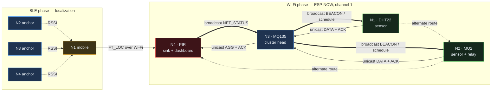

# System Architecture

**23CSE341 WSN — Lab Evaluation 2** · deliverable: *Architecture diagram*

---

## 1. System overview

```
┌──────────────────────────────────────────────────────────────────────────────┐
│                      HYBRID BLE + Wi-Fi SENSOR NETWORK                       │
├──────────────────────────────────────────────────────────────────────────────┤
│                                                                              │
│   N1  SENSOR                N2  SENSOR / RELAY         N3  CLUSTER HEAD      │
│   ┌──────────────┐          ┌──────────────┐          ┌──────────────────┐   │
│   │ DHT22        │          │ MQ2          │          │ MQ135            │   │
│   │ temp + hum   │          │ smoke / LPG  │          │ air quality      │   │
│   ├──────────────┤          ├──────────────┤          ├──────────────────┤   │
│   │ BLE  mobile  │          │ BLE  anchor  │          │ BLE  anchor      │   │
│   │ trilaterates │          │              │          │                  │   │
│   │ itself       │          │              │          │ TDMA scheduler   │   │
│   ├──────────────┤          ├──────────────┤          │ time master      │   │
│   │ CSMA/CA      │          │ CSMA/CA      │          │ AGGREGATOR       │   │
│   │ TDMA slot 1  │          │ TDMA slot 2  │          │ ROUTER           │   │
│   │ originates   │          │ originates   │          │ TDMA slots 0, 4  │   │
│   │ data         │          │ + RELAYS     │          │                  │   │
│   └──────┬───────┘          └──────┬───────┘          └────────┬─────────┘   │
│          │                         │                           │             │
│          │   unicast + ACK         │   unicast + ACK           │ aggregated  │
│          └────────────┬────────────┘                           │ unicast     │
│                       ▼                                        ▼             │
│                  ╔═════════════════════════════════════════════════════╗     │
│                  ║            N4   SINK / GATEWAY                      ║     │
│                  ║  HC-SR501 motion  ·  BLE anchor  ·  never sleeps    ║     │
│                  ║  metrics: PDR, loss, delay, throughput, retx        ║     │
│                  ║  SoftAP "WSN_SINK"  →  http://192.168.4.1           ║     │
│                  ╚═════════════════════════════════════════════════════╝     │
│                                                                              │
│   ◀══ broadcast: BEACON/schedule (N3), ROUTE_UPDATE (any), NET_STATUS (N4)   │
└──────────────────────────────────────────────────────────────────────────────┘
```

---

## 2. Protocol stack

Everything above the radio is implemented in this project. Nothing in the
shaded band is inherited from a library — that is the point of the exercise.

```
  ┌─────────────────────────────────────────────────────────────────┐
  │  APPLICATION   sensing · alarms · dashboard · metrics           │
  │                wsn_sensors · wsn_metrics · dashboard_html       │
  ├─────────────────────────────────────────────────────────────────┤
  │  AGGREGATION   min/max/mean fusion, alarm OR, data reduction    │ ░
  │                wsn_aggregate                                    │ ░
  ├─────────────────────────────────────────────────────────────────┤
  │  NETWORK       neighbour table · 5-parameter cost metric ·      │ ░
  │                failure detection · alternate route · recovery   │ ░
  │                wsn_route                                        │ ░
  ├─────────────────────────────────────────────────────────────────┤
  │  SCHEDULING    TDMA superframe · dynamic slot grant/revoke ·    │ ░
  │                beacon time sync · sleep/wake                    │ ░
  │                wsn_tdma                                         │ ░
  ├─────────────────────────────────────────────────────────────────┤
  │  MAC           CCA (physical + NAV) · DIFS · random backoff     │ ░
  │                with freeze · ACK · timeout · BEB · retry limit  │ ░
  │                wsn_mac                                          │ ░
  ├─────────────────────────────────────────────────────────────────┤
  │  FRAMING       21-byte header · CRC-16 · path list · NAV field  │ ░
  │                wsn_protocol                                     │ ░
  ├═════════════════════════════════════════════════════════════════┤
  │  TRANSPORT     ESP-NOW  (802.11 vendor action frames)           │  ← vendor
  │  RADIO         ESP32 2.4 GHz · one radio, shared with BLE       │  ← silicon
  └─────────────────────────────────────────────────────────────────┘

        BLE side (parallel, time-multiplexed onto the same radio):
  ┌─────────────────────────────────────────────────────────────────┐
  │  LOCALIZATION  median → EWMA → log-distance → trilateration →   │ ░
  │                error / RMSE · nearest-node proximity            │ ░
  │                wsn_ble                                          │ ░
  ├═════════════════════════════════════════════════════════════════┤
  │  BLE GAP       advertising + active scanning (Bluedroid)        │  ← vendor
  └─────────────────────────────────────────────────────────────────┘
```

---

## 3. Why the two radios are time-multiplexed

The ESP32 has **one** 2.4 GHz radio shared between Wi-Fi and Bluetooth. With
both stacks transmitting, the coexistence arbiter starves the BLE scan window,
and RSSI — the quantity the whole localization result depends on — becomes
unstable and biased.

The firmware therefore runs the two in alternating phases, which also happens
to be exactly the demonstration sequence the guidelines specify:

```
   ┌── PHASE A · BLE ─────────────────── ~6 s ──┐
   │  advertise + active scan                    │
   │  RSSI samples → median → EWMA               │
   │  log-distance path loss → distance          │
   │  trilateration → (x, y) → error, RMSE       │
   │  BLE RSSI handed to the routing metric      │
   │  BLEDevice::deinit(true) → ~60 kB freed     │
   └──────────────────┬──────────────────────────┘
                      ▼
   ┌── PHASE B · Wi-Fi ──────────────── ~30 s ──┐
   │  beacon + schedule + time sync              │
   │  CSMA/CA → TDMA slot → unicast + ACK        │
   │  aggregation at N3                          │
   │  multi-hop → sink                           │
   │  metrics, dashboard, sleep slots            │
   └──────────────────┬──────────────────────────┘
                      └──────► back to Phase A
```

Wi-Fi itself stays **initialised** throughout; only the BLE stack is cycled.
That is what lets ESP-NOW peers and the sink's SoftAP survive across phases.

**The sink is the exception.** It advertises permanently (so it is always
available as an anchor) but never scans, and never leaves Phase B — a blocking
4-second scan would stall the dashboard it has to keep serving. This is a
deliberate asymmetry: a mains-powered gateway trades energy for availability.

---

## 4. Where BLE and Wi-Fi actually meet

A common weakness in a "hybrid" design is that the two halves never interact —
BLE is demonstrated, then Wi-Fi is demonstrated, and nothing connects them.
Here there are three real couplings:

| Coupling | Mechanism |
|---|---|
| **BLE RSSI → routing** | `routeNoteBleRssi()` feeds the filtered BLE RSSI into the route cost. When a neighbour's Wi-Fi RSSI is not yet known, the BLE measurement selects the next hop. |
| **Localization → sink** | N1 computes its position over BLE and reports it to the sink over Wi-Fi as an `FT_LOC` frame, so the dashboard's localization panel is fed through the Wi-Fi network. |
| **Shared radio budget** | The phase machine is itself the coupling: Wi-Fi traffic is suppressed during ranging so that RSSI is measured on a quiet medium. |

---

## 5. Frame format

```
  byte  0   1   2   3   4     5      6    7    8  9    10 11 12 13   14 15
      ┌───┬───┬───┬───┬─────┬──────┬────┬────┬──────┬────────────┬────────┐
      │MAG│VER│TYP│SRC│ DST │FINAL │HOP │TTL │ SEQ  │  txTimeMs  │durUs   │
      └───┴───┴───┴───┴─────┴──────┴────┴────┴──────┴────────────┴────────┘
       16     17 18 19 20          21 .. N              N+1  N+2
      ┌──────┬──────────────┐  ┌───────────────┐  ┌──────────────┐
      │pathLn│  path[4]     │  │    payload    │  │    CRC-16    │
      └──────┴──────────────┘  └───────────────┘  └──────────────┘
         21-byte header            type-dependent      CCITT
```

| Field | Purpose |
|---|---|
| `src` / `dst` / `finalDst` | `dst` is the **next hop**, `finalDst` the destination. Separating them is what makes multi-hop forwarding possible. |
| `hop`, `ttl` | Hop count for the metric; TTL bounds a routing loop. |
| `seq` | Per-originator sequence. The sink derives PDR and loss from gaps in it. |
| `txTimeMs` | Network time at **origination**, never re-stamped on a retry — so end-to-end delay includes the cost of retransmissions. |
| `durationUs` | NAV: how long the sender expects to hold the medium. Overhearing nodes treat the channel as busy for that long (virtual carrier sense). |
| `path[4]` | Nodes traversed. Gives the sink a printable route (`1→3→4`) and lets a forwarder drop a looping frame. |

### Frame types

| Type | Cast | Carries |
|---|---|---|
| `HELLO` | broadcast | liveness, hop count, cost, next hop, alarm, retx |
| `BEACON` | broadcast | slot map, schedule version + reason, network time |
| `ROUTE_UPDATE` | broadcast | link up/down, new next hop, new cost |
| `NET_STATUS` | broadcast | sink's PDR, loss, delay, throughput, reduction |
| `CMD` | broadcast | demonstration control |
| `DATA` | unicast | one node's sensor reading |
| `AGG` | unicast | min/max/mean across contributors + reduction counters |
| `LOC` | unicast | trilateration result → sink |
| `SLOT_REQ` | unicast | backlog / alarm report → cluster head |
| `ACK` | unicast | acknowledgement of a data-bearing frame |

This mapping is exactly what the guidelines require: control, schedule, route
and status information is **broadcast**; sensor data, next-hop traffic,
aggregated data and acknowledgements are **unicast**.

---

## 6. TDMA superframe

```
  ├──────────────────────── 2000 ms superframe ─────────────────────────┤
  │  0      │  1     │  2     │  3      │  4     │  5     │  6   │  7   │
  │ BEACON  │ DATA   │ DATA   │ DYNAMIC │ AGG    │ CAP    │STATUS│SLEEP │
  │  N3     │  N1    │  N2    │  (none) │  N3    │  all   │  N4  │  --  │
  │ 250 ms  │ 250 ms │ 250 ms │ 250 ms  │ 250 ms │ 250 ms │250ms │250ms │

  N1 awake:   ███      ███                                 ███
  N2 awake:   ███      ███      ███                        ███
  N3 awake:   ███      ███      ███       ███      ███     ███
  N4 awake:   ████████████████████████████████████████████████████████  (never sleeps)
```

Slot 3 is unassigned by default — a sleep slot. The cluster head grants it on
demand, which is what makes the schedule dynamic rather than fixed:

| Trigger | Action | Reason code |
|---|---|---|
| A node's gas/motion alarm fires | grant slot 3 to it | `ALARM_GRANT` |
| The alarm clears | return slot 3 to sleep | `ALARM_RELEASE` |
| A node reports a backlog ≥ 3 | grant slot 3 to it | `BACKLOG_GRANT` |
| A node misses 3 consecutive slots | revoke its slot | `NODE_SILENT` |
| That node transmits again | restore its slot | `NODE_REJOIN` |
| `collide` is issued | two owners in slot 5 | `COLLISION_TEST` |

Every change increments `schedVersion` and is broadcast with its reason.
Version numbering also makes adoption safe: a stale beacon overheard late can
never roll the network backwards.

---

## 7. Routing

```
   cost(neighbour) = 100·(hops+1)              ← hop count
                   + 150·(1 − rssiNorm)        ← RSSI / link quality
                   + 200·(1 − ackRate)         ← successful ACK rate
                   + 100·lossRate              ← packet loss
                   = ∞   if the link is down   ← link availability

   rssiNorm maps −95 dBm → 0 and −35 dBm → 1
   RSSI source: Wi-Fi (from the MAC sniffer), falling back to BLE
```

All five parameters the guidelines list are used. ACK rate carries the heaviest
weight because it is the most direct evidence that a link actually delivers —
RSSI can look healthy on a link that is failing.

### Failure and recovery

```
   1. LINK FAILURE        N3 powered off, or `fail 3`
            │
   2. DETECTION           3 consecutive ACK losses   ──or──  7 s of silence
            │             (catches links we transmit on)  (catches a dead node
            │                                              we never send to)
            ▼
   3. ROUTE UPDATE        cost(N3) := ∞ ; broadcast ROUTE_UPDATE
            │
   4. ALTERNATE SELECTED  next-lowest cost wins:  N1 → N2 → N4
            │
   5. DELIVERY CONTINUES  sink keeps receiving; path list now reads 1→2→4
            │
   6. RECOVERY            N3 heard again → link marked up → costs recomputed →
                          the original path wins back on merit, not by force
```

The two detectors exist because they catch different failures. Failover
latency (step 2 → step 4) is measured and reported.

---

## 8. Module map

| Module | Responsibility | Lab requirement served |
|---|---|---|
| `wsn_config` | MACs, coordinates, pins, all tuning | Setup, addressing |
| `wsn_protocol` | Frame format, CRC, path handling | Addressing, broadcast/unicast |
| `wsn_log` | Human + CSV output streams | Screenshots, performance data |
| `wsn_sensors` | DHT22/MQ2/MQ135/PIR, warm-up, calibration, faults | Sensing |
| `wsn_ble` | Advertise, scan, filter, range, trilaterate | **BLE localization (3)** |
| `wsn_mac` | CCA, NAV, DIFS, backoff, ACK, BEB, retry | **Wi-Fi MAC (3)** |
| `wsn_tdma` | Superframe, dynamic slots, time sync, sleep | **Scheduling (2)** |
| `wsn_route` | Neighbour table, cost, failure, recovery | **Routing (2)** |
| `wsn_aggregate` | Min/max/mean fusion, reduction accounting | **Aggregation (2)** |
| `wsn_metrics` | PDR, loss, delay, throughput, retx, reduction | **Performance (2)** |
| `wsn_node` | Phase machine, slot actions, frame dispatch | Integration |
| `wsn_cli` | Serial command interface | Demonstration |
| `dashboard_html` | Seven-panel live dashboard | **Dashboard** |

---

## 9. Mermaid source (for the report)


